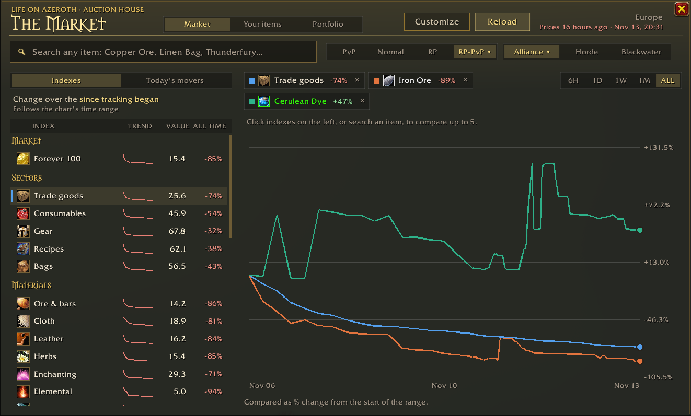
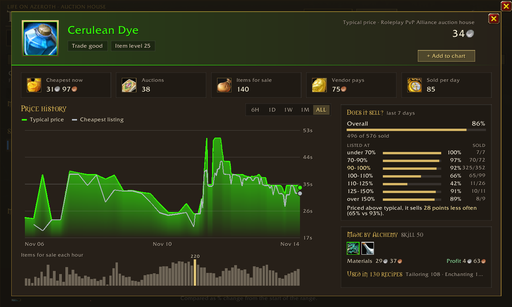
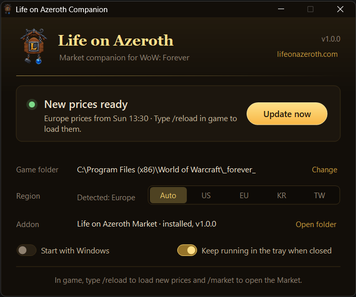

# Life on Azeroth: Market

The auction house market from [lifeonazeroth.com](https://lifeonazeroth.com/#economy), inside WoW: Forever.

- **Price indexes** for the whole market, sectors, materials, consumables and gear, with trends and change over the last 6 hours, a day, a week, a month or all time. **Prices update every hour**, and the last three days are kept hour by hour.
- **Your own auction house:** prices for your ruleset and faction, so they match what you see in game. Switch to any other house with one click.
- **Item tooltips** show the typical price, and the stack price when you hover a stack.
- **Charts** that compare up to five indexes or items.
- **Item search** across everything seen on the auction house, with typical and cheapest price, auctions, items for sale and vendor price.
- **Item cards** with price history, items for sale each hour, the price in every region and similar items.

Open it with `/market` or the coin by your minimap.

## How prices get into the game

Addons cannot go online, so a small companion app does that part.

1. Get the addon from [CurseForge](https://www.curseforge.com/wow/addons/lifeonazeroth-market), so it keeps itself up to date.
2. Download `LifeOnAzerothCompanion.exe` from the [latest release](https://github.com/sanredz/LifeOnAzeroth-Addon/releases/latest) and run it. There is nothing to install. It finds your game and downloads new prices every hour into a small `LifeOnAzeroth_Data` addon. If WoW is already open the first time, restart the game once so it shows up.
3. In game, type `/reload` or shift-click the minimap coin to load the newest prices.

The app can start with Windows and keeps running in the tray when you close it. Right-click the tray icon to quit.

Windows may say the app is unrecognised the first time. Click **More info**, then **Run anyway**.

## Slash commands

| Command | Does |
| --- | --- |
| `/market` or `/loa` | Opens or closes the Market. |
| `/market minimap` | Shows or hides the minimap button. |

## License

All rights reserved. The addon and the companion app are free to use for your own play, and the code is public so you can see what they do, but it is not open source: please don't copy, modify or redistribute it. See [LICENSE](LICENSE).
