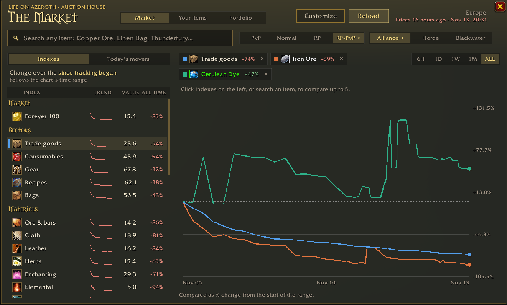
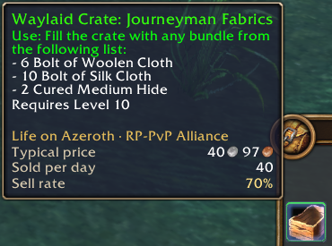
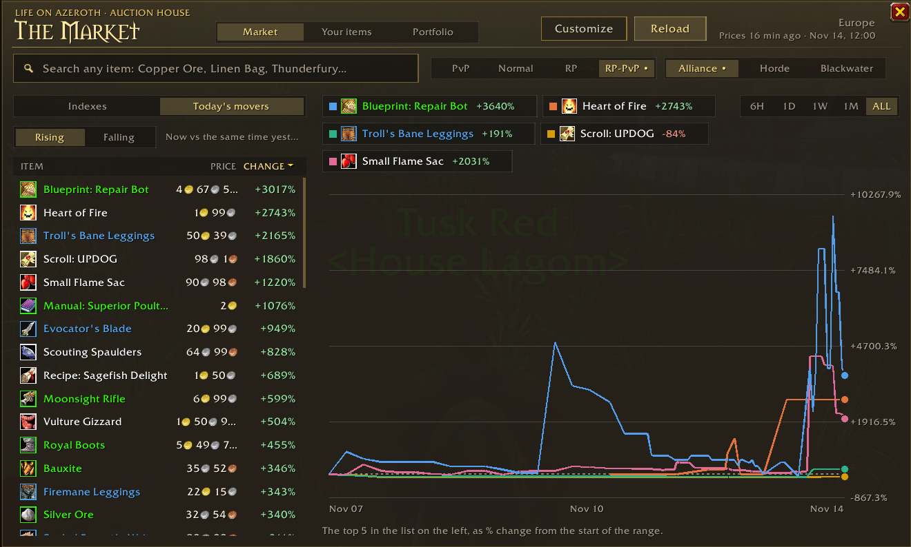
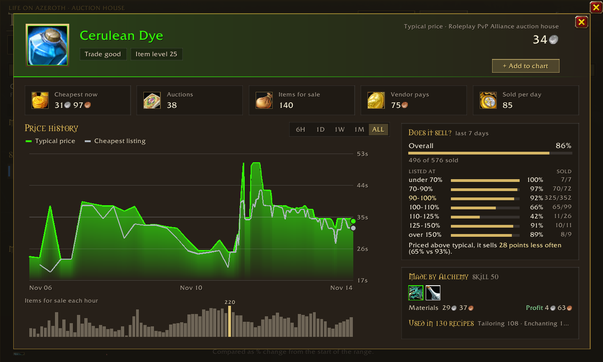
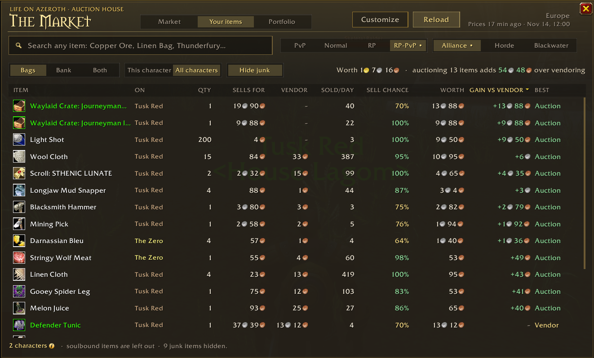
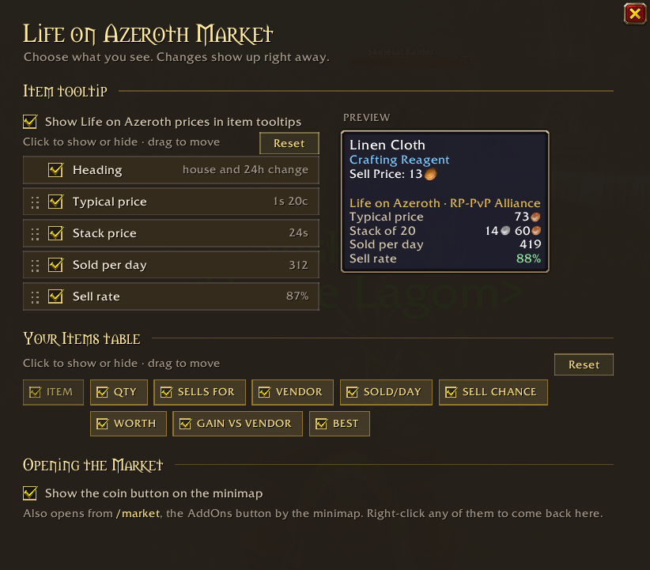
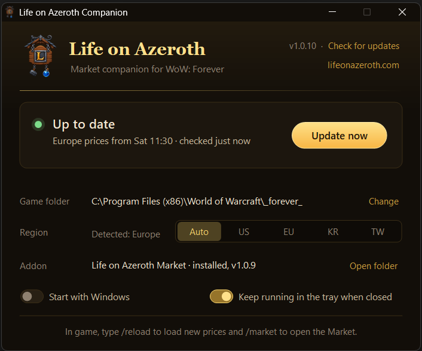

# CurseForge page (kept in sync by hand)

Paste into authors.curseforge.com -> project -> Description (Markdown mode).
Images load from the public GitHub repo (`media/`), so replacing a file there
with the same name updates the page.

**Summary (one line):**

> Auction house prices, trends and sell rates for your own auction house in WoW: Forever, right in your tooltips.

**Description:**

```markdown
# Life on Azeroth: Market

Auction house prices for WoW: Forever, inside the game. Every auction house in every region is read once an hour, so you see what things actually sell for on your own auction house, how prices have moved, and whether something is worth listing at all.

It stays out of your way: a couple of lines in your item tooltips, and a window you open when you want the full picture.



## What it does

**Prices in your tooltips.** Hover anything in your bags, the bank, loot or chat to see its typical price on your auction house, the price of the whole stack and how many sell per day. You choose which lines show up and in what order.



**The Market window** (`/market`):

- **Indexes** for the whole market, trade goods, ore, cloth, herbs, consumables, gear and more, with trends over 6 hours, a day, a week, a month or all time.
- **Today's movers:** what rose and fell the most since yesterday.
- **Compare up to five** indexes or items on one chart.
- **Search any item** seen on the auction house.
- **Any auction house:** it opens on your own ruleset and faction, and every other house is one click away.



**Every item has its own page:** typical and cheapest price, auctions up, items for sale, vendor price and sold per day, price history, and **Does it sell?**, which shows how often it actually sold at each price over the last week. Crafted items show what they're made from and whether crafting them is a profit or a loss, and materials show what they're used in.



**Your items:** everything in your bags and bank, on one character or all of them, with what it sells for, sold per day, sell chance, what it's worth and whether to auction or vendor it. **Portfolio** tracks your net worth over time.



**Customize** picks the tooltip lines and table columns you want, with a live preview. Open it from the Customize button, the AddOns menu or `/market options`.



## Getting prices into the game

Addons can't go online, so a small companion app does that part.

1. Get the addon from CurseForge (you're here) so it keeps itself up to date.
2. Download `LifeOnAzerothCompanion.exe` from the [latest release](https://github.com/sanredz/LifeOnAzeroth-Addon/releases/latest) and run it. There's nothing to install. It finds your game and downloads new prices into a small **Life on Azeroth: Data** addon while WoW is running.
3. Type `/reload` in game, or Shift-click the coin by your minimap, to load the newest prices.

It can start with Windows and keeps running in the tray. When there's a new version, the app tells you and links to the GitHub page.

The app isn't code signed, so Windows may say it's unrecognised the first time: click **More info**, then **Run anyway**. Some antivirus programs have flagged older versions by mistake. If that happens to you, get the latest version from GitHub.



## Commands

| Command | Does |
| --- | --- |
| `/market` or `/loa` | Opens or closes the Market |
| `/market options` | Opens Customize |
| `/market tooltip` | Turns the tooltip lines on or off |
| `/market minimap` | Shows or hides the minimap coin |

## What it touches

The addon only draws its own window and tooltip lines. It doesn't change the auction house or Blizzard's UI, and it never sends anything.

The companion app only talks to lifeonazeroth.com and only writes to the Life on Azeroth folders in your AddOns folder.

Found a bug? [Open an issue](https://github.com/sanredz/LifeOnAzeroth-Addon/issues).

Source, releases and issues: [github.com/sanredz/LifeOnAzeroth-Addon](https://github.com/sanredz/LifeOnAzeroth-Addon)
```
